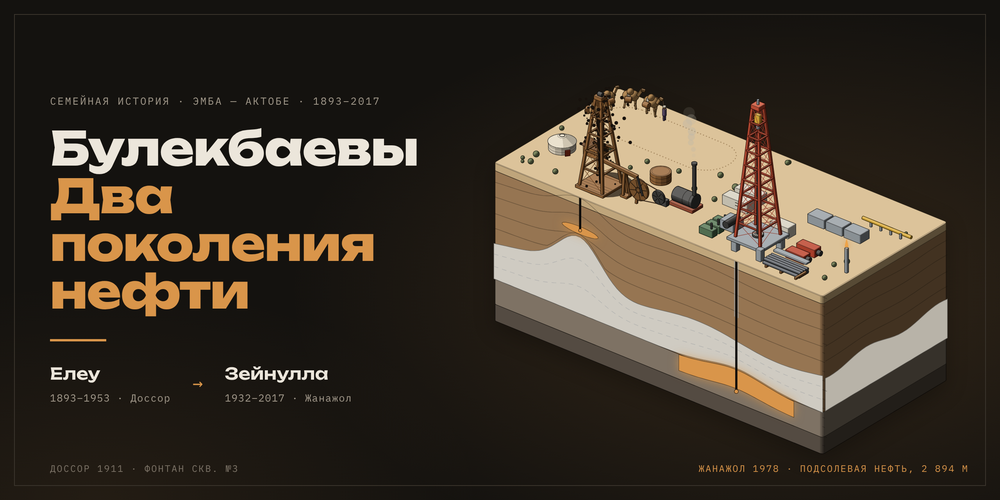

# Булекбаевы. Два поколения нефти



Семейная история в виде одностраничного сайта: Елеу Булекбаев (1893–1953) строил первые промыслы Эмбы, его сын Зейнулла Елеуович Булекбаев (1932–2017) открыл подсолевую нефть Актюбинской области.

## Фоновая сцена

На фоне страницы работает живая изометрическая 3D-сцена, построенная китом [Anatomy](https://github.com/wheresryan22/anatomy) (MIT, `vendor/anatomy/`): твёрдые детали со светотенью в четыре тона, порядок художника, плавное движение.

- **Доссор, 1911**: деревянная вышка ударно-канатного бурения, балансир на стойке, ленточное колесо с шатуном, паровой котёл с дымом, юрта, контора, деревянный резервуар, караван верблюдов с бочками воды. На разделе «29.04.1911» бьёт фонтан скважины № 3.
- **Жанажол, 1978**: стальная вышка, вращающийся ротор, талевый блок, лебёдка, дизели, буровые насосы, стеллаж с трубами, вагончики, газопровод, факел.
- **Под землёй**: разрез — надсолевые слои, соляной купол, подсолевой палеозой. При прокрутке части II долото проходит соль, и залежь загорается.

Каждый кадр сцена заново проецируется камерой, поэтому при прокрутке она поворачивается и приближается к нужной эпохе. При `prefers-reduced-motion` сцена неподвижна.

## Сборка

```sh
node build.mjs              # src/page.html + src/scene.js + vendor/anatomy → index.html, banner.html
node scripts/banner.cjs     # banner.png (README) и og.jpg (превью ссылки), нужен Playwright
```

`index.html` самодостаточен (кроме шрифтов Google Fonts) и подходит для GitHub Pages.

## Источники

Перечислены в подвале страницы. Факты сверены с публикациями Informburo, Tengrinews, Diapazon, myaktobe.kz, Казинформ и справочными описаниями месторождений; расхождения отмечены на странице.
